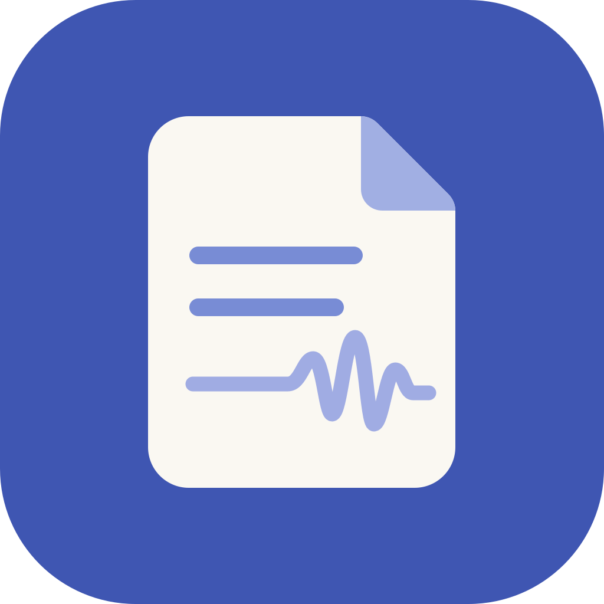

<p align="center"></p>

# EasyNotes

EasyNotes turns YouTube videos and article pages into notes that you can read in a few minutes. Paste one or more links, a playlist, or a topic. The app writes the notes and can record an audio version of supported YouTube notes on your Mac.

Each note has these parts:

- A TL;DR, which is a summary of two or three sentences.
- The key ideas, each with a link to its timestamp in the video.
- The frameworks that the speaker teaches, if the video has them.
- Two to four quotes from the speaker.
- Action items as checkboxes.
- A glossary that explains each abbreviation and jargon term.

When a process, a cycle or a system is easier to understand as a picture, the note also has a diagram. The model writes the diagram in [Mermaid](https://mermaid.js.org) text, and [Pele](https://pele.run) draws it in the app and in the Chrome extension. The diagram uses the colors of the light or dark theme. If Pele can't read a diagram, the app shows its Mermaid text instead. Audio versions skip diagrams.

Notes use a spoken tone. They read like a friend who watched the video and explains it to you out loud: everyday words, short sentences, and no filler. Burmese notes use spoken Burmese, not formal written Burmese.

Burmese videos and articles get Burmese notes. Audio is unavailable for Burmese notes because the current Kokoro voices do not support Burmese.

## Requirements

EasyNotes runs on macOS. The audio feature needs a Mac with Apple silicon. Install these tools before you start:

- Python 3.10 or later.
- [yt-dlp](https://github.com/yt-dlp/yt-dlp), which gets the video data and the captions.
- [uv](https://docs.astral.sh/uv/), which runs the transcript fallback and the audio engine in separate environments.
- [ffmpeg](https://ffmpeg.org/), which compresses the audio.
- The Antigravity CLI (`agy`), which writes the notes with Gemini. Sign in once. pi (`pi`) and Claude Code (`claude`) also work, as the Choose a model section shows.

To install the first four tools with Homebrew, run this command:

```bash
brew install python yt-dlp uv ffmpeg
```

For audio, download the Kokoro model once. Kokoro is a small text-to-speech model that runs on your Mac. The app uses the copy on your disk and does not connect to Hugging Face again.

```bash
uvx --from huggingface_hub hf download mlx-community/Kokoro-82M-bf16
```

## Start the app

Go to the project folder and start the server:

```bash
cd ytnotes
python3 ytnotes.py
```

The app opens at `http://127.0.0.1:8765` in your browser. Paste a YouTube link into the box and press Enter. Notes for a one-hour video take about one minute.

To read several videos, paste one link on each line. Press Shift+Enter to start a new line. The app writes up to three notes at the same time.

If you paste a playlist link, the app reads the first 50 videos of the playlist. A playlist link contains `/playlist?list=`. A video link that also contains `list=` gives only that video.

If you type a topic instead of a link, the app finds the best videos about the topic. Select how much video it covers, from 30 minutes to 4 hours. The app then writes one note for each video.

Each playlist and each topic becomes a collection in the library. A collection page shows each video with its TL;DR, in playlist order. Each note in a collection has links to the previous and the next video.

To listen to a note, select Listen. The first recording of a note takes about one minute. After that, the audio starts immediately. The player continues while you read other notes, and it remembers your position in each note.

To delete a note, select the trash button next to Listen, and then select Delete. The app removes the note and its audio. You can't undo this. The Chrome extension has the same button.

Glossary terms have a dotted underline in the text. Select a term to see what it means. The full glossary is at the end of each note.

## Search, read marks, highlights and export

Type in the Search box at the top of the library to find words in the text of your notes, not only in the titles. Each note that matches shows a short piece of the text around the word. Every word that you type must appear in the note. Select Unread to hide the notes that you have read.

A note counts as read when you scroll to its end. To change this yourself, select Mark read or Mark unread below the title.

To keep a passage, select some text in a note. A small bar appears above the text. Select Highlight to mark the passage, or Add a comment to write a note about it. Your highlights appear at the end of the note, and you can remove them there. They are saved on your Mac in `notes/highlights.json`.

To take your notes elsewhere, use these downloads:

- Export under a note saves that note as a Markdown file. The file has a short header with the title, the channel and the link, and it lists your highlights at the end. Obsidian and most other note apps can open it.
- Export all in the library saves every note as a Markdown file in a zip file.
- Flashcards in the library saves each glossary term as a row of a CSV file. In Anki, choose Import and select the file. The file has no header row, and each row has the term, its explanation, and the title of the note.

## Today: a daily watch list

Today is a short list of new videos that are worth your time. It uses only the channels that you choose, so YouTube's recommendations do not decide what you see.

1. Select Today at the top of the library.
2. Add the channels that you trust. Paste a channel link, an @handle, or a link to one of its videos. Or select Add the channels in my notes.
3. The app reads the new uploads of each channel from its RSS feed. It leaves out Shorts, live streams, videos from more than 3 days ago, videos that you already have notes for, and videos that were on an earlier list.
4. The model reads the titles and descriptions, compares them with the notes in your library, and keeps up to 8 videos. Each pick has one line that says what you get from it.

Select Make notes to read a pick instead of watching it. While the server runs, it makes a new list once a day. Select Check again to make it now. The Chrome extension shows the same list above the library.

To make the list from the command line, run `python3 ytnotes.py --daily`. The first time, it adds the channels of your notes.

## Use the app on your phone

Your phone and your Mac must be on the same Wi-Fi network. Start the server with the `--lan` flag:

```bash
python3 ytnotes.py --lan
```

The server shows a second address, for example `http://192.168.1.117:8765`. Open that address on your phone. On an iPhone, select Share and then Add to Home Screen to get an app icon.

Use `--lan` only on a network that you trust. The app has no password, so each device on the network can open it.

## Use the Chrome extension

The Chrome extension shows your notes next to the video on YouTube. Select a timestamp to jump to that part of the video, or select Make notes for a video that has no notes yet. The server must be running.

To install it, go to `chrome://extensions`, turn on Developer mode, select Load unpacked, and select the `extension` folder. See [extension/README.md](extension/README.md) for more.

## Command line

You can also use EasyNotes without the browser. Each command saves its result in the `notes/` folder:

| Command | Result |
|---|---|
| `python3 ytnotes.py "https://youtu.be/VIDEO_ID"` | Writes notes for one video. |
| `python3 ytnotes.py "https://youtu.be/ID_1" "https://youtu.be/ID_2"` | Writes notes for each video. |
| `python3 ytnotes.py "https://www.youtube.com/playlist?list=PLAYLIST_ID"` | Writes notes for the first 50 videos of a playlist and saves the playlist as a collection. |
| `python3 ytnotes.py "saas distribution" -t 60` | Writes notes for the best videos on a topic, about 60 minutes of video in total. |
| `python3 ytnotes.py "https://youtu.be/VIDEO_ID" --audio --voice bm_george` | Writes notes and records the audio in the voice that you select. |
| `python3 ytnotes.py --daily` | Makes today's watch list from your channels and prints it. |
| `python3 ytnotes.py --add-glossary` | Adds a glossary to old notes that do not have one. |
| `python3 ytnotes.py --model openai-codex/gpt-6-luna` | Uses a different model. See the Choose a model section. |
| `python3 ytnotes.py --port 8766` | Starts the server on a different port. |
| `python3 ytlearn.py "saas distribution" -t 60` | Makes a playlist link with short takeaways in the `playlists/` folder. |

The voices are `af_heart` (the default), `af_bella`, `am_michael`, `am_fenrir`, `bf_emma`, and `bm_george`. The letters `a` and `b` mean American and British. The letters `f` and `m` mean female and male.

## Choose a model

The default model is `gemini-3.8-flash`, which runs through agy. Burmese notes, glossaries, and topic summaries use `gemini-3.8-flash-high` by default. Use `--model` to select one model for every language; an explicit choice such as `--model openai-codex/gpt-6-luna` is honored for Burmese too. Topic picks use the English default unless you set `--model`.

| Value of `--model` | CLI that runs |
|---|---|
| A Gemini model, for example `gemini-3.8-flash` or `gemini-3.8-flash-high` | agy |
| `provider/model`, for example `openai-codex/gpt-6-luna` or `opencode-go/gpt-6-luna` | pi |
| A Claude model, for example `claude-haiku-5-5` or `sonnet` | Claude Code |
| `agy:`, `pi:`, or `claude:` followed by a model name | The CLI that the prefix names |

To see the models that agy can use, run `agy models`. For pi, run `pi --list-models`. The model setting is part of the server command, for example `python3 ytnotes.py --model claude-haiku-5-5`.

pi runs with its tools, sessions, extensions, and project files turned off. It gets only the prompt and the transcript.

## How it works

The app makes a note in these steps:

1. yt-dlp gets the title, the channel, the length, the chapters, the description, and the captions of the video. For Burmese originals, it prefers Burmese captions; otherwise it prefers English and falls back to Burmese.
2. If YouTube blocks the caption download, youtube-transcript-api gets the captions in a different way, in the same language.
3. agy, pi, or Claude Code writes the notes from the chapters and the transcript. Notes use a spoken tone. Burmese notes and glossary definitions use spoken Burmese.
4. The app and the Chrome extension draw each `mermaid` code block in the note as a diagram with Pele. Pele loads only when a note has a diagram.
5. For audio, `tts.py` changes the notes into a spoken script and Kokoro records it. ffmpeg then compresses the recording to an `.m4a` file.

Before saving Burmese output, the app checks for unrelated foreign scripts and editing remarks. It allows foreign names that appear in the source, and Latin technical terms. If the check fails, it asks the model to repair the output once. If that repair still fails, the app reports an error instead of saving the text.

## Files

The project has these files and folders:

| Path | Contents |
|---|---|
| `ytnotes.py` | The server and the command line tool. |
| `ytnotes.html` | The app that opens in the browser. |
| `tts.py` | The script that records audio with Kokoro. |
| `ytlearn.py` | The video search and the playlist builder. |
| `daily.py` | The daily watch list: your channels, their RSS feeds, and the picks. |
| `library.py` | Search, highlights, and the Markdown and flashcard exports. |
| `context.py` | The code that gets chapters and reads article pages. |
| `llm.py` | The code that sends prompts to agy, pi, or Claude Code. |
| `assets/` | The app icon in SVG and PNG. |
| `extension/` | The Chrome extension. Its `vendor/` folder also has the copy of Pele that the app uses. |
| `notes/` | Your notes, the audio files, `index.json`, and `collections.json`. Git ignores this folder. |
| `playlists/` | The playlists from `ytlearn.py`. Git ignores this folder. |

## Troubleshooting

These are the errors that you can see, and what to do:

- "No English or Burmese transcript available": The video has no English or Burmese captions, or YouTube blocks both caption methods. Try again later or use a different video.
- "Address already in use": Another copy of the server is running. Stop it with Ctrl+C, or start the server with `--port 8766`.
- "529 Overloaded" or a similar error from the model: The model provider is busy. Try again after a few minutes.
- "Notes failed" with a sign-in message: Sign in to agy, pi, or Claude Code again, then try again.
- The audio does not start: Make sure that you downloaded the Kokoro model. See the Requirements section.

## Credits

EasyNotes uses work from these projects:

- [pi](https://github.com/earendil-works/pi) and [Claude Code](https://claude.com/claude-code), which run the models.
- [Kokoro-82M](https://huggingface.co/hexgrad/Kokoro-82M), the [mlx-community](https://huggingface.co/mlx-community/Kokoro-82M-bf16) conversion, and [mlx-audio](https://github.com/Blaizzy/mlx-audio).
- [Pele](https://github.com/obsidianmd/pele) by Obsidian, MIT license, which draws the diagrams. A copy is in `extension/vendor/`.
- [yt-dlp](https://github.com/yt-dlp/yt-dlp) and [youtube-transcript-api](https://github.com/jdepoix/youtube-transcript-api).
